# Qubit Command Design

[中文版](design.zh_CN.md) · [User Guide](user_guide.md) · [README](../README.md)

This document records the current `qubit-command` command-runner contract. It is
for maintainers and callers that need to reason about process ownership, I/O
helpers, termination, and the information preserved in failures. The user
guide remains the entry point for runnable examples.

## Purpose

`CommandRunner` turns an external process into one bounded application step.
The runner owns the child process, its stdout/stderr readers, and an optional
stdin writer until normal completion or a terminal error. It keeps process
control, stream collection, output limits, cancellation, timeout, and
diagnostic redaction explicit. It does not install signal handlers, define a
shell language, cache command output, or make captured process data safe.

## Public Contract

- `Command` describes a program, structured arguments, environment and working
  directory changes, and stdin. `Command::new` does not invoke a shell;
  `Command::shell` explicitly selects `sh -c` on Unix-like systems or `cmd /C`
  on Windows.
- `CommandRunner` supplies timeout, successful-exit-code, output-capture,
  logging, timer, and redaction policy. `run` is synchronous; `run_with`
  accepts per-run options such as cancellation and tee files.
- `CommandOutput` carries exit status, retained stdout/stderr bytes, elapsed
  time, truncation flags, and `stdout_complete()`/`stderr_complete()`.
- Diagnostics treat the payload generated by `Command::shell` as an opaque
  secret. Whole-script automatic redaction is limited to that generated form
  and recognized shell argument forms; manually constructed interpreter
  invocations such as `bash -c` or `powershell -Command` must use
  `sensitive_arg` or `sensitive_arg_os` when the script contains sensitive
  content. General argument heuristics do not guarantee hiding a whole script.
- `CommandError` exposes a stable `kind()` classification and optional output.
  `output()` borrows retained output and `into_output()` moves it out.
  `captured_output()` borrows captured bytes, while `into_captured_output()`
  moves them out independently, preserving stream markers and preferring a
  retained `CommandOutput` when both carriers exist. The consuming method also
  consumes the error diagnostics. Cleanup failures are available through
  `cleanup_failures()` and do not replace the primary error.

The default captures at most 1 MiB per output stream and treats exit code zero
as success. `stdin_file` and tee paths must identify ordinary files. A tee is
replaced at the beginning of a run, not appended. Callers that use
`unbounded_output()` accept unbounded in-memory process data themselves.

Relative paths configured with `stdin_file`, `tee_stdout_to_file`, and
`tee_stderr_to_file` are opened relative to the parent process's current
directory. A command or runner working-directory setting changes only the
child process directory. Callers that want a file under the child directory
must join the path to an explicit directory before configuration.

Output-file preparation and commit are not a filesystem transaction. Path and
file-identity checks are intended to keep conflicting files from being
truncated, but they do not promise that every failure has no side effects.
Commit opens stdout before stderr, so an absent stdout path may be created as
an empty file if opening stderr fails. After both handles pass identity checks,
stdout is truncated before stderr; if the second truncation fails, stdout may
be empty while stderr retains its old bytes, and the child has not started. A
later spawn failure does not restore old tee contents. Applications that must
retain prior logs should use a distinct path per run and decide how to archive
or replace files after success; the library makes no atomic-replacement
promise. No child process does not mean no tee file side effects.

Error formatting uses controlled source summaries: I/O sources expose only
their `ErrorKind` and optional raw OS error code, while time-source details are
omitted. The original source objects and `Error::source()` chain remain
available and may contain arbitrary text. Callers that format a complete raw
error chain are responsible for handling that text.

`max_total_output_bytes(limit)` optionally sets a hard budget shared by stdout
and stderr. It also enables process-tree management when no timeout or
cancellation policy is configured. The reader observes at most `limit + 1`
bytes in total; the extra byte is a sentinel proving that the budget was
exceeded. Bytes omitted by per-stream retention caps still count toward the
shared budget. Retention caps alone do not prevent tee writes, but cancellation
observed after a read can skip tee I/O for bytes already read and accounted. A
tee write failure disables further writes to that destination while draining
may continue; a flush failure may also leave the tee incomplete. Neither the
observed byte count nor retained capture proves tee completeness. The sentinel
is included in the observed count when available.

An exceeded budget returns `OutputLimitExceeded` without inventing a natural
process exit status. Its partial bytes are available from
`CommandError::captured_output()`, while `CommandError::output()` is `None`.
Use `CommandError::into_captured_output()` to move retained bytes out as an
independent value, including for this budget-only carrier. It preserves stream
completeness and truncation markers and does not clone the buffers. Captured
bytes are raw process output and may contain sensitive data; callers remain
responsible for handling them safely.
For other errors, `output()` is present only when finalization assembled a
`CommandOutput`; `captured_output()` can still expose partial data when no
natural status, elapsed time, or complete helper result could be assembled.
The captured accessors expose raw process bytes, so callers remain responsible
for handling sensitive output.

## Ownership States

The runner moves through these ownership states:

1. **Prepared:** command values and file paths are validated. Input/tee path
   conflicts and non-regular files fail before a child is spawned or a tee is
   truncated. Open tee handles remain paired with their diagnostic paths;
   pairing does not mean that the files have been committed.
2. **Committed:** the final startup cancellation check has passed, tee files
   have been opened, validated, and truncated in the documented order, and
   stdin has been attached to the process command. This state owns the
   command text, spawn-ready process command, pending stdin bytes, and paired
   tee handles. A failed commit releases these resources.
3. **Started:** the child and all requested I/O helpers have been created.
   The child process, reader threads, writer thread, cancellation handles, and
   timer are owned by one running-command state.
4. **Observed:** the child has exited, timed out, or cancellation was observed.
   The runner still owns the child status and helper results while it applies
   the completion policy.
5. **Finalized:** every helper that can be joined within the contract has been
   joined and its result has been folded into `CommandOutput` or cleanup
   diagnostics. On Windows, one shared confirmation deadline is established
   before cancellation requests are issued and is consulted only after a
   failed helper-cancellation request; it is not reset for each helper. If
   cancellation succeeds, the helper is joined directly; success does not
   confirm completion, and that join is not bounded by the deadline. Only a
   failed cancellation request triggers completion checks against the shared
   deadline. A helper whose failed cancellation remains unconfirmed may be
   detached and finish when its pipe closes.

The final startup cancellation check is the linearization point. Cancellation
before it produces `CancelledBeforeStart` without creating or truncating tee
files. Cancellation after it is an in-flight cancellation and may retain
partial output.

## Run Events

The normal event order is:

1. Validate the command, file kinds, path conflicts, and cancellation state,
   producing a prepared command.
2. Perform the final pre-start cancellation check, the documented linearization point.
3. Commit the prepared command: open and validate tee handles, truncate stdout before stderr, and attach stdin before spawning the child. A failed commit may have the file side effects described above.
4. Spawn the child with the required process-tree management enabled.
5. Record the post-spawn monotonic start instant, start the optional stdin writer
   and stdout/stderr readers, then poll child status, timeout, application
   cancellation, and total-output-budget state.
6. On ordinary exit, join helpers and assemble output.
7. On timeout or cancellation, terminate the managed process tree, request
   helper cancellation, collect available bytes, and classify the primary
   policy result.

The timeout starts after spawn, before I/O helper startup. Helper initialization
time counts toward the timeout; command preparation and spawn time do not.
Timeout, cancellation, and total-output-budget monitoring use timer-based
polling. This applies when a total output budget is configured by itself, so
its timer must continue progressing independently while the synchronous `run`
call blocks.
The byte budget is not a hard wall-clock deadline and does not bound preparation,
spawning, or arbitrary filesystem operations. A cancellation handle is
one-shot and idempotent; repeated `cancel()` calls do not create additional
transitions.

## Termination

When process-tree management is available, the runner first requests tree
termination. If that request fails, it checks whether the child already exited,
then tries direct-child termination. The original tree-termination source is
retained as a cleanup failure when the child status can still be confirmed.
Wait and kill errors are mapped without discarding earlier termination
evidence. If the final child status cannot be confirmed, the initiating stop reason
remains primary and all process-control failures remain cleanup evidence.

Termination is best effort with respect to descendants and external effects.
The runner does not promise to undo work already performed by a child or by a
descendant that escaped the managed process tree.

Startup errors call the same termination policy explicitly before returning. Both
failed kill requests with unknown status never lead to a blocking wait. OS wait
after an accepted kill and ordinary-file I/O are not hard-deadline operations.

## I/O Finalization

Each output reader and optional stdin writer owns a cancellation token and a
join handle. All cancellation requests are issued before waiting on any one
helper, so one failed request cannot prevent the others from being attempted.
On ordinary completion, helper results are joined and stream bytes are
returned. On interruption, available bytes are retained and the corresponding
`*_complete()` flag is false when the helper did not drain its pipe to EOF.

On Unix, readers and stdin writers use non-blocking operations plus a wake-up
channel so cancellation can be observed without waiting for an escaped
descendant to close an inherited pipe. On Windows, synchronous operations are
interrupted through `CancelSynchronousIo`. Success means the cancellation
request succeeded; it does not establish that the helper has stopped. The
runner then joins that helper, and this join is not limited by the 100 ms
deadline. The runner establishes one shared 100 ms helper-confirmation
deadline before issuing cancellation requests and consults it only when a
Windows cancellation request fails; it is not reset for each helper or a hard
deadline for the whole call. After that deadline expires it returns a bounded result with a
`StdoutCancellation`, `StderrCancellation`, or `StdinCancellation` cleanup
failure as applicable; the helper may remain alive until its pipe closes.
The successful-cancellation interleaving investigation is summarized in the
[current Windows cancellation status](windows-cancellation-status.md); the
[RC-002 verification history](rc-002-verification.md#current-summary) retains
the detailed evidence.

Output truncation is independent of stream completeness. A complete stream can
be truncated in memory, and an incomplete stream can contain fewer bytes than
the configured limit. Callers must check both kinds of metadata before treating
retained bytes as a complete transcript.

## Error Precedence

The primary error describes the first decisive failure in the operation's
policy. Secondary failures observed while terminating the child or finalizing
helpers are retained in `cleanup_failures()` in deterministic helper order.
The order is process tree, direct child, wait, clock, stdout, stderr, stdin.
`Time` retains clock failures observed during finalization. Demoting a helper
error also moves its retained output into the primary error. `KillFailed` and
`CancelFailed` are removed; timeout and cancellation never change primary kind
because cleanup failed. The monitor polls completed stdout/stderr readers while
waiting for the child and for inherited output pipes after child exit. If a read
failure is observed before another terminal event, the runner stops the child and
returns the collector's original read error with retained output. If process
termination fails, its process-control error remains primary and reader errors
remain cleanup details. A tee write
failure that happened earlier on the same stream remains primary under the existing
collector ordering. Budget, child-wait, cancellation, timeout, and clock decisions
retain their existing priority when already selected. With no monitoring policy,
the runner polls using an adaptive 1–10 ms sleep and stops only the direct child;
it does not enable process-tree management solely because a reader failed. A
failure observed before the deadline can therefore change a previous `TimedOut`
result into `ReadOutputFailed`. Process termination and ordinary-file I/O are not
hard-deadline operations. Callers using partial output should inspect the primary
error, cleanup failures, and stream-completeness flags.

A tee failure remains observable if draining later ends through cancellation
or a pipe read failure. Within that stream the earlier tee failure precedes
the later read failure; both survive demotion to cleanup details. Captured
bytes are retained before tee writes. Stream completeness records pipe EOF,
so a failed tee flush does not make an already drained stream incomplete.

Preparation, thread-start, timer, and process-control failures may not carry a
`CommandOutput`. Timeout, cancellation, truncation, unexpected exit, output
read, tee-write, and final stdin-write failures carry output whenever status,
elapsed time, and stream state can be assembled. A cleanup failure does not
make partial output complete and does not imply that a descendant was stopped.

While monitoring a live child, an observed total-budget overrun is checked
before child status, cancellation, or timeout; otherwise the child status is
checked before cancellation and timeout. After child exit, the I/O-finalization
loop checks budget overrun, cancellation, then timeout. A normal join returns
the reader's output as the authority for that stream. A budget snapshot is
used only for streams whose helper result could not be joined; this preserves
partial output without discarding completed reader results. The checked
precedence and output cases are covered by `total_output_limit_tests`,
`running_command_tests`, and `output_collector_tests`.

## Platform Semantics

Unix uses process groups and non-blocking pipe polling. Path-backed stdin and
tee files are opened with non-blocking safety flags, checked through the live
handle, then restored to blocking mode before use. This prevents a FIFO path
replacement from blocking preparation.

Windows uses Job Objects for process-tree management where configured and
keeps pipe handles suitable for synchronous I/O. `CancelSynchronousIo` is the
normal helper interruption mechanism. Its failure is observable through the
typed cancellation cleanup failure and the shared 100 ms confirmation
deadline above, which is consulted only after a failed request. That rule does
not bound the subsequent join or the whole call, and does not imply that the
operating system closes a pipe immediately. The current investigation status is
summarized in the [Windows cancellation status](windows-cancellation-status.md);
the [RC-002 verification history](rc-002-verification.md#current-summary)
retains the detailed evidence.

Other platforms perform handle-authoritative ordinary-file checks but cannot
portably guarantee that every device-namespace open returns promptly. Broken
remote or FUSE filesystems can still stall an operating-system operation; such
stalls are outside the command timeout contract.

## Testing Seams

The runner accepts an injected timer and clock, which lets tests advance time
without sleeping through a real timeout. Process-control wrappers, file
preparation, output readers, tee writers, cancellation tokens, and cleanup
failure mapping are tested at their seams. Integration tests also exercise
real commands, shell selection, non-UTF-8 values, ordinary-file rejection,
process-tree cleanup, cancellation, timeout, truncation, tee output, and
redacted diagnostics.

## Coverage Gates

Changes to lifecycle behavior must retain tests for normal exit, timeout,
startup cancellation, in-flight cancellation, helper cancellation failure,
partial output, cleanup-error precedence, and both Unix and Windows-specific
paths where the platform APIs differ. Documentation examples are compiled as
doctests or by the repository Markdown checker. Package validation must include
both README files, both user guides, and both design documents, and must not
depend on files excluded from the Cargo archive.

## Known Limits

- The library cannot validate the semantics of a target program's arguments or
  shell script; callers own input validation.
- Process-tree termination and helper interruption depend on operating-system
  capabilities. Descendants can keep inherited pipes open, and a Windows
  helper can outlive the bounded confirmation window.
- Captured output and tee files are raw process data even when diagnostics are
  redacted. Callers must apply their own retention and access policy.
- Timeout excludes preparation and spawn. It does not bound arbitrary kernel
  operations on untrusted or remote filesystems.
- Any future public lifecycle change must update the error contract, stream
  completeness semantics, both language guides, and this design document.

## Managed Execution Architecture

The managed API layers local admission, operation observation, and recovery on
the synchronous `CommandRunner`; it does not replace the runner's process and
I/O contract. `CommandExecutor` asks `BoundedScheduler` for a reservation,
builds an `AdapterState`, and submits it to `OperationManager`. The adapter
keeps the request and reservation recoverable until activation transfers them
to the scheduler. `ProcessBackend` then prepares any owned files and invokes
`run_with_tree_policy`. These boundaries are implemented in
`execution/executor.rs`, `execution/adapter/state.rs`, and
`execution/backend/process_backend.rs`.

```mermaid
stateDiagram-v2
    [*] --> Admission
    Admission --> Rejected: capacity / closed / deadline
    Admission --> Reserved: reservation acquired
    Reserved --> PreparedAdapter: operation manager accepts
    Reserved --> Rejected: manager rejects; request restored
    PreparedAdapter --> Activated: scheduler activates
    PreparedAdapter --> ActivationFailed: scheduler activation fails; ExecutionFailed published
    PreparedAdapter --> Abandoned: accepted operation abandoned; inputs dropped
    Activated --> FilePreparation
    FilePreparation --> FailedRecovery: owned-file preparation fails
    FilePreparation --> Running: files prepared; start authorized
    Running --> Outcome: process result selected and published
    Running --> Reaping: uncertain child/helper cleanup
    Reaping --> Recovery: ownership retained or transferred
    Recovery --> Settlement
    Outcome --> Settlement: input released, cleanup known
    Outcome --> Pending: cleanup still owned by recovery
    Pending --> Recovery
    ActivationFailed --> Settlement: released settlement
    Abandoned --> Settlement: released settlement
    Rejected --> [*]
    Settlement --> [*]
```

Admission rejection occurs before process execution and the submit failure
retains the unaccepted request. Once `OperationManager` accepts the operation,
activation failure is a distinct terminal operation result: the adapter
publishes `ExecutionFailed` and a released settlement, and it drops the
unavailable or rejected inputs. Abandoning a prepared, accepted operation
also drops its inputs and releases its reservation; it is not a submit
rejection and does not restore the request. Resource preparation happens after activation;
it can fail after ownership transfer, so the failure path retains the original
resource input and a capacity lease for recovery. Once the runner commits file
resources, truncation and later spawn failures can have filesystem side
effects, as described in the runner contract above. An operation outcome is a
one-shot result, not proof that process, helper, file, or capacity ownership has
settled. `CommandOperation` callers observe settlement separately; a
`RecoveryRequired` settlement preserves effects that still require recovery.

| Owner | Handoff | Release condition |
| --- | --- | --- |
| Executor request and reservation | Executor to prepared adapter, then scheduler on activation | Manager rejection restores the unaccepted request; accepted activation failure or abandon drops its inputs and settles released; an activated reservation record is removed after its owner and all leases are released |
| Child process and I/O helpers | Runner to `RunningCommand`; uncertain cleanup moves the owner to the reaper | Helpers and child are joined/reaped, or retained recovery ownership completes; a successful Windows cancellation request alone does not release the helper |
| Owned stdin/stdout/stderr files | Resource input to `PreparedFiles`, then runner I/O state | Normal finalization closes them; preparation failure retains them for recovery; file commit may already have changed output contents |
| Reservation owner and lease | Reservation owner retains a lease for runner/recovery cleanup | Accounting is released only when the scheduler record is removed after the final lease; releasing the operation owner alone may leave a lease active |
| Session endpoints | Submission context keeps endpoints alive while `SessionBridge` connects channels to process workers | Caller closes the stdin writer to signal EOF; stdout/stderr are drained concurrently; endpoints settle when execution and retained owners release the bridge and keepalive |
| Reaper and recovery handle | Runner transfers uncertain child/helper cleanup to reaper; recovery owner can be retained by the manager | Reaper completion or explicit recovery releases the retained owner; pending work remains observable and is not reported as released early |

Each session stdout/stderr queue remains bounded to 64 KiB. Before the aggregate
session budget is exceeded, producers wait for queue capacity and advance only
by bytes actually published. The configured budget is shared by both streams;
exactly `N` observed bytes are valid, and the first observed `N + 1` byte marks
the output incomplete and triggers termination. Explicit endpoint discard,
stop, or reader loss can drain bytes without publication. The final external
`CommandExecutor` handle owns a private scheduler-lifetime token: dropping it
closes admission and wakes idle workers, while accepted jobs and leases retain
their normal settlement path. This asynchronous drain is not proof of cleanup;
callers that need completion evidence continue using shutdown and settlement.

The legacy `CommandRunner::run` and `run_with` entry points remain synchronous
and do not provide executor admission, operation settlement, or managed
recovery observation. Managed execution uses the same runner with a
`RunTreePolicy`; the default `CommandRunOptions` selects managed process-tree
handling. For sessions, closing the caller's stdin endpoint lets the
child observe EOF while stdout and stderr readers continue draining. Output
limits still follow the runner's configured capture policy; the managed
`max_queued_input_bytes` field is a legacy-named estimate of reserved file
bytes, not an in-memory input or output limit.

`request_shutdown` first closes scheduler admission and then requests manager
shutdown. Callers must continue observing the returned shutdown handle while
it is pending; a snapshot or sleep does not establish that workers, reaper
owners, or recovery effects have finished. On Windows, successful synchronous
I/O cancellation is followed by a join that is not bounded by the failed-call
confirmation window. The production reachability investigation remains
unresolved; see [Windows cancellation status](windows-cancellation-status.md).

## Managed submission contract

Managed resource submission validates the complete I/O configuration before it registers resources. Owned stdout/stderr sinks are truncated only at the final I/O commit after admission and startup authorization; a partial commit can still leave an earlier sink changed. A rejected submission before commit does not truncate sinks. Session stdin uses the session pipe; file stdin and session stdin are mutually exclusive, while byte-prefix stdin remains supported.

Relative managed stdin and tee paths resolve from the parent process directory captured at submission. The child's working directory is selected separately, with the command override taking precedence over the runner default. Windows drive-relative paths retain Windows path semantics and are not treated as ordinary paths rooted at the captured directory. Request snapshots retain the compatibility `environment` field as empty; child environment behavior remains inherited at process start with explicit clear/remove/override operations applied.

Scoped capacity waits recheck stop and deadline while waiting. A scope stop maps to `AdmissionError::Stopped`; an expired deadline maps to `CapacityFailure::DeadlineExpired`. Waiter quota exhaustion and retry timer failures are represented by `CommandSubmitFailureReason::Wait(CommandSubmitWaitFailure)`: the latter distinguishes `WaiterLimit` from `Timer(RetryTimerFailure)`, whose kinds include startup, full, and disconnected failures.

Collect-style managed methods wait for settlement but expose only the command result or stop diagnostic. Submit handles are required to inspect settlement effects, recovery evidence, and resource release. `ProcessTreePolicy::DirectChild` is an explicit managed-only exception; legacy `run` and `run_with` keep their prior lifecycle.
