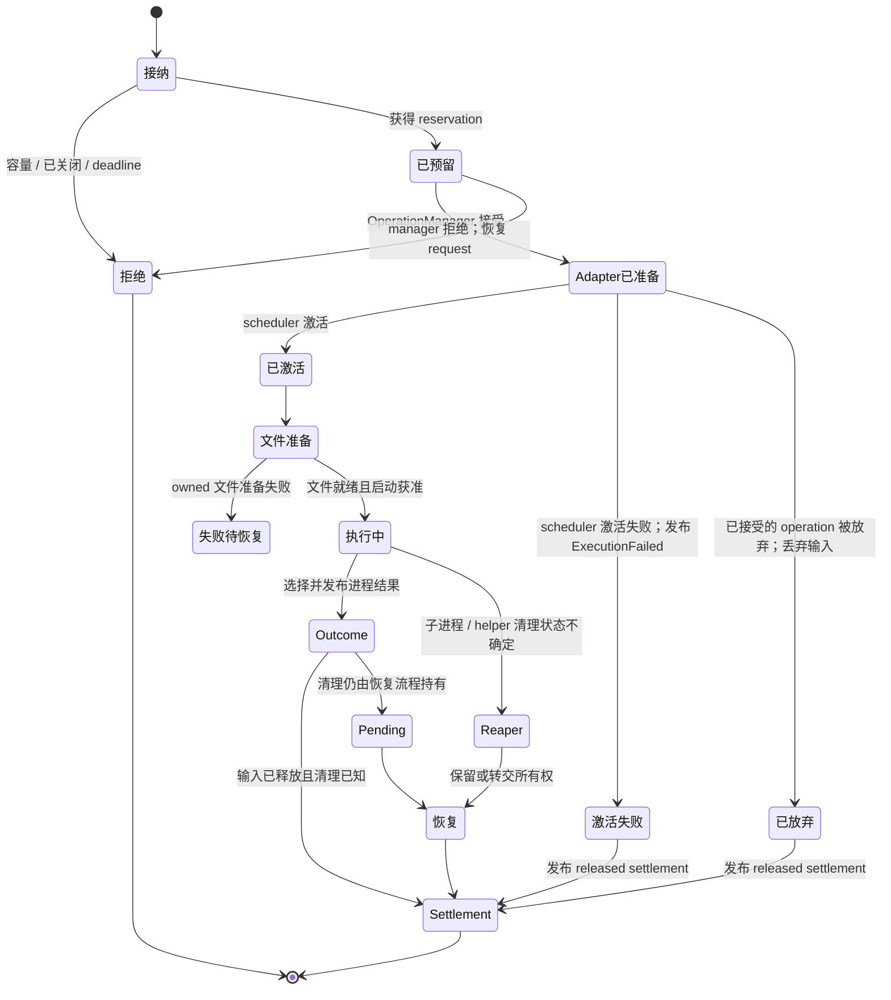

# Qubit Command 设计说明

[English](design.md) · [用户指南](user_guide.zh_CN.md) · [中文 README](../README.zh_CN.md)

本文记录当前 `qubit-command` 的 command runner 契约，面向需要理解进程所有权、I/O
helper、终止流程以及错误保留信息的维护者和调用方。可运行示例仍以用户指南为入口。

## 目的

`CommandRunner` 将外部进程变成一个有边界的应用步骤。runner 从启动到正常结束或终态
错误，一直拥有子进程、stdout/stderr reader 和可选的 stdin writer。进程控制、流采集、
输出上限、取消、超时和诊断脱敏都显式可见。本 crate 不安装信号处理器，不定义 shell
语言，不缓存命令输出，也不会让进程输出自动变得安全。

## 公共契约

- `Command` 描述程序、结构化参数、环境变量和工作目录变更，以及 stdin。`Command::new`
  不调用 shell；`Command::shell` 明确选择类 Unix 平台的 `sh -c` 或 Windows 的 `cmd /C`。
- `CommandRunner` 提供超时、成功退出码、输出捕获、日志、timer 和脱敏策略。`run` 是
  同步入口，`run_with` 接受取消句柄和 tee 文件等单次运行选项。
- `CommandOutput` 携带退出状态、保留的 stdout/stderr 字节、耗时、截断标志和
  `stdout_complete()`/`stderr_complete()`。
- 诊断会将 `Command::shell` 生成的脚本参数视为不透明 secret。自动整段脚本脱敏仅限该
  生成形式及识别出的 shell 参数形式；手工构造的 `bash -c` 或 `powershell -Command` 等
  解释器调用若脚本含敏感内容，必须使用 `sensitive_arg` 或 `sensitive_arg_os`。一般参数
  启发式不保证隐藏整段脚本。
- `CommandError` 通过稳定的 `kind()` 分类并可选地携带输出。`output()` 借用保留输出，
  `into_output()` 将其取出。`captured_output()` 借用捕获字节，
  `into_captured_output()` 独立移出字节并保留流标记；两个载体同时存在时优先选择
  `CommandOutput`。消费式方法也会消费错误诊断。清理失败由 `cleanup_failures()` 提供，
  不替代主错误。

默认每个流最多捕获 1 MiB，退出码 0 表示成功。`stdin_file` 和 tee 路径必须指向普通
文件；每次运行开始时 tee 会被替换而不是追加。调用 `unbounded_output()` 就意味着调用方
自行接受无界的进程内存输出。

通过 `stdin_file`、`tee_stdout_to_file` 和 `tee_stderr_to_file` 配置的相对路径，以父进程
当前目录为基准打开。command 或 runner 的工作目录设置只改变子进程目录。若调用方希望访问
子进程目录下的文件，必须在配置前将路径显式拼接到指定目录。

输出文件准备和提交不是文件系统事务。路径及文件身份检查旨在避免冲突文件被截断，但不承诺
所有失败都没有文件副作用。commit 先打开 stdout，再打开 stderr，因此打开 stderr 失败时，
原本不存在的 stdout 路径可能已创建为空文件。两个句柄通过身份检查后，先截断 stdout，再
截断 stderr；若第二次截断失败，stdout 可能已为空而 stderr 保留旧字节，子进程尚未启动。
之后若 spawn 失败，也不会恢复 tee 文件原有内容。若应用必须保留旧日志，应为每次运行使用
独立路径，并在成功后自行决定如何归档或替换；库不承诺原子替换。未启动子进程不等于没有
tee 文件副作用。

错误格式化使用受控 source 摘要：I/O source 仅显示其 `ErrorKind` 和可选的原始 OS 错误
编号，时间 source 详情则省略。原始 source 对象及 `Error::source()` 链仍可访问，其中可能
包含任意文本。调用方若格式化完整原始错误链，应自行负责这些文本的处理。

`max_total_output_bytes(limit)` 可选设置 stdout 与 stderr 共享的硬预算。即使没有配置超时或
取消策略，它也会启用进程树管理。reader 总共最多观察 `limit + 1` 个字节；额外的一个字节
作为哨兵证明预算已超限。因单流保留上限而未保留的字节仍计入共享预算。保留上限本身不会阻止
tee 写入；但读取后若观察到取消，已读取并计数的字节可能不会写入 tee。tee 写入失败会停止向该
目标继续写入，而读取可能继续；flush 失败也可能使 tee 不完整。预算观察量和内存捕获结果都不能
证明 tee 文件完整。若观察到哨兵，它会计入实际观察量。

预算超限返回 `OutputLimitExceeded`，不会伪造自然进程退出状态。部分字节可从
`CommandError::captured_output()` 读取，此时 `CommandError::output()` 为 `None`。其他错误只有在
收尾成功组装 `CommandOutput` 时才会有 `output()`；若无法组装自然状态、耗时或完整 helper
结果，`captured_output()` 仍可能提供部分数据。捕获访问器暴露原始进程字节，调用方需自行
负责敏感输出的处理。

调用 `CommandError::into_captured_output()` 可将保留字节作为独立值移出，包括仅有预算错误
载体的情况。该方法保留流完整性和截断标记，不会克隆缓冲区；原始进程输出可能包含敏感数据，
调用方仍需负责安全处理。

## 所有权状态

runner 按以下状态转移：

1. **已准备：** 校验命令、文件类型、路径冲突和取消状态。输入或 tee 路径冲突、非普通
   文件会在启动子进程及截断 tee 文件之前失败。已打开的 tee 句柄始终与其诊断路径配对；
   完成配对本身不表示文件已提交。
2. **已提交：** 最终启动前取消检查已通过，tee 文件已按规定顺序打开、校验并截断，stdin
   已附接到进程命令。此状态拥有命令文本、可启动的进程命令、待写入的 stdin 字节及配对的
   tee 句柄。提交失败会释放这些资源。
3. **已启动：** 子进程和所需 I/O helper 都已创建。子进程、reader 线程、writer 线程、
   取消句柄和 timer 由同一个运行状态拥有。
4. **已观察：** 子进程已退出、超时或观察到取消。runner 仍保留进程状态和 helper 结果，
   直到完成策略处理完毕。
5. **已终结：** 契约允许 join 的 helper 已结束，其结果已合并到 `CommandOutput` 或清理
   诊断。在 Windows 上，runner 会在发出 helper 取消请求前统一设定一个共享确认截止时间，
   且不会为每个 helper 重置。取消请求成功则直接 join；成功不表示 helper 已结束，且该 join
   不受截止时间限制。只有取消请求失败时，才会按共享截止时间检查 helper 是否结束。取消失败
   且在期限内仍未确认结束的 helper 可能脱离 join，并在管道关闭后结束。

启动前的最终取消检查是线性化点。此前取消返回 `CancelledBeforeStart`，不会创建或截断
tee 文件；此后取消属于运行中取消，并可能保留部分输出。

## 运行事件

正常事件顺序如下：

1. 校验命令、文件类型、路径冲突和取消状态，生成 prepared command。
2. 执行最终启动前取消检查；这是文档所述的线性化点。
3. 提交 prepared command：打开并校验 tee 句柄，先截断 stdout、再截断 stderr，并在启动子进程前附接 stdin。提交失败可能产生上文所述的文件副作用。
4. 启用所需的进程树管理并启动子进程。
5. 记录启动后的单调时钟时刻，启动可选的 stdin writer 和 stdout/stderr reader，然后轮询进程状态、超时、应用取消和总输出预算状态。
6. 正常退出时 join helper 并组装输出。
7. 超时或取消时终止受管进程树，请求取消 helper，收集可用字节，并确定主错误类别。

超时在子进程启动后、I/O helper 启动前开始计时；helper 初始化时间计入超时，命令准备和
spawn 时间不计入。超时、取消和总输出预算监控都使用基于 timer 的轮询；即使只配置总输出
预算也如此，因此同步 `run` 阻塞时 timer 仍必须独立推进。字节预算不是墙钟硬期限，也不限制
准备、spawn 或任意文件系统操作。取消句柄是一次性且幂等的；重复调用 `cancel()` 不会产生
额外状态迁移。

在 managed 执行中，单个 operation 的 stop 请求只影响该运行。应用可将同一个
`CommandCancellation` token 的 clone 传给多个运行，再取消共享 token 来广播取消。gate
会把每次运行首次接受的停止原因记为主原因；后续观察可以补记 stop 状态，但不会替换主原因。
旧 `run`/`run_with` 及 token clone 的广播行为保持既有契约。

## 终止

具备进程树管理时，runner 首先请求终止整棵进程树。请求失败后，会检查子进程是否已经
退出，再尝试直接终止子进程。如果仍能确认子进程状态，原始的树终止原因会作为清理失败
保留。等待和 kill 错误会在不丢失更早终止证据的前提下映射；若无法确认最终状态，仍保留原停止原因，进程
控制失败通过清理信息返回。

终止对于后代进程和外部副作用只能尽力而为。runner 不承诺撤销子进程或脱离受管进程树
的后代已经完成的工作。

启动错误通过同一终止策略显式收尾。两次 kill 均失败且状态未知时，不进入阻塞 wait。
成功提交 kill 后的回收等待和普通文件 I/O 不属于硬超时承诺。

## I/O 收尾

每个输出 reader 和可选 stdin writer 都拥有取消 token 与 join handle。runner 会先发出
全部取消请求，再等待任一 helper，因此某个请求失败不会阻止其他请求。正常结束时 join
所有 helper 并返回流字节；中断时保留可取得的字节。如果 helper 没有读到管道 EOF，相应
的 `*_complete()` 会为 false。

Unix reader 和 stdin writer 使用非阻塞操作及唤醒通道，因此不会等待逃逸的后代关闭继承
的管道。Windows 使用 `CancelSynchronousIo` 中断同步操作。调用成功只表示取消请求成功，
并不能证明 helper 已停止。随后 runner 会 join 该 helper；这个 join 不受 100 ms 截止时间限制。
runner 会在发出取消请求前统一设定一个共享的 100 ms helper 确认截止时间，只有请求失败时才会
检查该时间，且不会为每个 helper 重置；它也不是整个调用的硬期限。超过该截止时间后，runner 返回有界结果，并按需
保留 `StdoutCancellation`、`StderrCancellation` 或 `StdinCancellation` 清理失败；对应
helper 可能一直存活到管道关闭。
成功取消后的交错核查摘要与当前证据见[Windows 取消状态](windows-cancellation-status.zh_CN.md)；详细审计记录保留在[RC-002 Windows 取消验证历史](rc-002-verification.md#current-summary)中。

输出截断与流完整性相互独立。完整流仍可能在内存中被截断，不完整流也可能只包含少量
字节。将保留字节当成完整 transcript 前，调用方必须同时检查这两类元数据。

## 错误优先级

主错误说明运行策略中第一个决定性失败。终止子进程或收尾 helper 时观察到的次级失败按
进程树、直接子进程、wait、时钟、stdout、stderr、stdin 的顺序放入 `cleanup_failures()`。
收尾采样时钟失败以 `Time` 保留；降级 helper 错误时同时移动可用输出。
`KillFailed` 和 `CancelFailed` 已移除，清理失败不再改变超时或取消的主错误类别。runner
会在等待子进程及子进程退出后的继承输出管道时轮询 stdout/stderr reader。若读取失败先于
其他终态被观察到，runner 会停止子进程；成功终止后，携带 collector 的原始读取错误和已保留
输出返回。若进程终止失败，进程控制错误仍是主错误，reader 错误保留为清理信息。
同一流中更早发生的 tee 写入失败仍按现有 collector 顺序作为主错误。预算、子进程等待、取消、
超时和时钟事件保留已选定的优先级。未配置监控策略时，runner 使用自适应 1–10 ms 间隔轮询，
只停止直接子进程；不会仅因 reader 故障而启用进程树管理。读取错误先于 deadline 被观察到时，
结果可能从原先的 `TimedOut` 变为 `ReadOutputFailed`。进程终止和普通文件 I/O 不属于硬截止
时间保证。使用部分输出时，应同时检查主错误、清理失败和流完整性标志。

tee 失败后，即使继续排空输出时发生取消或管道读取失败，已有 tee 错误也会保留。
同一流中先发生的 tee 错误优先于后续读取错误，两者降级到清理信息时仍完整保留。
捕获字节在 tee 写入之前保存；流完整性记录管道 EOF，因此 tee flush 失败不会将
已经排空的流标记为不完整。

准备、线程启动、timer 和进程控制错误可能不携带 `CommandOutput`。超时、取消、截断、
非预期退出、输出读取、tee 写入和最终 stdin 写入错误，在能够组装进程状态、耗时和流状态
时会携带输出。清理失败不会使部分输出变完整，也不表示所有后代都已停止。

监控仍存活的子进程时，检测到总预算超限会先于子进程状态、取消和超时检查；否则先检查子进程
状态，再检查取消与超时。子进程退出后的 I/O 收尾循环依次检查预算超限、取消、超时。reader
正常 join 后，其结果是该流的权威数据源；只有 helper 结果无法 join 时才使用预算快照，因此
既能保留部分输出，也不会丢弃已完成 reader 的结果。`total_output_limit_tests`、
`running_command_tests` 和 `output_collector_tests` 覆盖这些优先级及输出情况。

## 平台语义

Unix 使用 process group 和非阻塞管道轮询。文件型 stdin 与 tee 文件先使用非阻塞安全
标志打开，从活动句柄检查，再在交给子进程或 tee writer 前恢复阻塞模式；这样路径被替换
为 FIFO 时不会阻塞准备阶段。

Windows 在配置可用时使用 Job Object 管理进程树，管道句柄保持同步 I/O 语义，并通过
`CancelSynchronousIo` 作为正常 helper 中断机制。该调用失败会通过类型化 cancellation
cleanup failure 和上述共享的 100 ms 确认截止时间暴露出来；该时间只有请求失败时才会检查，且
不会为每个 helper 重置。它不限制后续 join 或整个调用，也不保证操作系统立即关闭管道。当前核查状态见[Windows 取消状态](windows-cancellation-status.zh_CN.md)；详细证据保留在[RC-002 验证历史](rc-002-verification.md#current-summary)中。

其他平台仍会依据活动句柄检查普通文件，但没有可移植的方法保证所有设备命名空间的打开
都能及时返回。损坏的远程或 FUSE 文件系统仍可能让操作系统调用停滞，这不属于命令超时
契约。

## 测试接缝

runner 接受注入的 timer 和 clock，测试可以推进时间而无需真实等待超时。进程控制包装、
文件准备、输出 reader、tee writer、取消 token 和清理失败映射都在各自接缝测试。集成测试
还覆盖真实命令、shell 选择、非 UTF-8 值、普通文件拒绝、进程树清理、取消、超时、截断、
tee 输出和脱敏诊断。

## 覆盖率门禁

生命周期变更必须继续覆盖正常退出、超时、启动前取消、运行中取消、helper 取消失败、
部分输出、清理错误优先级，以及 Unix/Windows 差异路径。文档示例通过 doctest 或仓库
Markdown 检查器编译。发布包验证必须包含两份 README、两份用户指南和两份设计文档，且不
得依赖 Cargo 归档中排除的文件。

## 已知限制

- 本库无法验证目标程序参数或 shell 脚本的语义；输入校验由调用方负责。
- 进程树终止和 helper 中断依赖操作系统能力。后代可能保持继承管道打开，Windows helper
  也可能超过有界确认窗口后仍存活。
- 即使诊断已经脱敏，捕获输出和 tee 文件仍是原始进程数据；保留和访问策略由调用方决定。
- 超时不包括准备和启动，也不限制不可信或远程文件系统上的任意内核操作。
- 后续公共生命周期变更必须同步错误契约、流完整性语义、双语指南和本文档。

## Managed 执行架构

Managed API 在同步 `CommandRunner` 之上增加本地接纳、操作观察和恢复能力，
不替代 runner 的进程与 I/O 契约。`CommandExecutor` 向 `BoundedScheduler` 申请
reservation，构造 `AdapterState` 并提交给 `OperationManager`。激活前，adapter
仍可恢复 request 和 reservation；激活后，调度器接管它们。随后
`ProcessBackend` 准备已拥有的文件，并调用 `run_with_tree_policy`。这些边界可在
`execution/executor.rs`、`execution/adapter/state.rs` 和
`execution/backend/process_backend.rs` 中核对。

接纳拒绝发生在进程执行前，submit failure 保留未接收的 request。`OperationManager`
接受 operation 后，激活失败属于不同的终态 operation 结果：adapter 发布
`ExecutionFailed` 和 released settlement，并丢弃不可用或被拒绝的输入。放弃已接受、
尚未激活的 operation 也会丢弃输入并释放 reservation；这不是 submit rejection，
也不会恢复 request。资源准备在激活后执行；准备失败时所有权已经转移，因此失败路径会保留原始资源输入和
capacity lease 以供恢复。runner 提交文件资源后，截断及后续启动失败可能产生
文件系统副作用，见上文 runner 契约。操作 outcome 是一次性结果，不代表进程、
helper、文件或容量所有权已经结算。`CommandOperation` 调用方需单独观察
settlement；`RecoveryRequired` settlement 表示仍有待恢复的效果。

| 所有者 | 交接 | 释放条件 |
| --- | --- | --- |
| Executor request 与 reservation | Executor 交给已准备的 adapter，激活时再交给 scheduler | Manager 拒绝时恢复未接受的 request；已接受后的激活失败或放弃会丢弃输入并以 released 结算；激活后的 reservation 记录在 owner 与全部 lease 释放后移除 |
| 子进程与 I/O helper | Runner 交由 `RunningCommand`；清理状态不确定时将 owner 交给 reaper | helper 与子进程 join/reap，或保留的恢复所有权完成；Windows 取消请求成功本身不代表 helper 已释放 |
| owned stdin/stdout/stderr 文件 | Resource input 交给 `PreparedFiles`，再交给 runner I/O 状态 | 正常结束时关闭；准备失败时保留以供恢复；文件提交可能已改变输出内容 |
| Reservation owner 与 lease | Reservation owner 为 runner/恢复清理保留 lease | scheduler 记录在 owner 与最后一个 lease 都释放后移除；仅释放操作 owner 时 lease 可能仍有效 |
| Session 端点 | 提交上下文保持端点存活，`SessionBridge` 将 channel 接到进程 worker | 调用方关闭 stdin writer 以发送 EOF；stdout/stderr 并发 drain；执行和保留的 owner 释放 bridge 与 keepalive 后端点才结算 |
| Reaper 与 recovery handle | Runner 将不确定的子进程/helper 清理交给 reaper；manager 可保留 recovery owner | Reaper 完成或显式恢复后释放保留 owner；pending 工作仍可观察，不能提前报告已释放 |

Session stdout/stderr 队列仍各自限制为 64 KiB。aggregate session 预算超限前，生产者等待队列容量，只按实际发布的字节推进。两个流共用一个预算；观察到恰好 `N` 字节仍有效，首次观察到第 `N + 1` 字节才标记输出不完整并触发终止。显式丢弃端点、停止写入或读端消失时，可以排空但不发布后续字节。最后一个外部 `CommandExecutor` handle 持有私有 scheduler 生命周期令牌：释放它会关闭接纳并唤醒空闲 worker，已接纳任务和 lease 仍按原有结算路径完成。后台排空不证明清理完成；需要完成证据时仍应继续观察 shutdown 与 settlement。

旧 `CommandRunner::run` 和 `run_with` 入口仍是同步 API，不提供 executor 接纳、
operation settlement 或 managed recovery 观察。Managed execution 通过
`RunTreePolicy` 使用同一个 runner；`CommandRunOptions` 默认选择 managed 进程树策略。
Session 中，调用方关闭 stdin 端点后子进程可观察到 EOF，同时 stdout 与 stderr
reader 继续 drain。输出限制仍由 runner 的捕获策略决定；managed
`max_queued_input_bytes` 是历史命名的预留文件字节估算，不限制内存 stdin 或输出。

`request_shutdown` 先关闭 scheduler 接纳，再请求 manager shutdown。调用方必须在
返回的 shutdown handle 仍为 pending 时继续观察；单次快照或 sleep 不能证明 worker、
reaper owner 或恢复效果已经完成。Windows 成功取消同步 I/O 后仍会 join，该 join
不受失败请求确认窗口限制。生产路径是否可达的调查仍未解决，见
[Windows cancellation status](windows-cancellation-status.md)。

## 受管提交契约

受管资源提交会先校验完整 I/O 配置，再登记资源。stdout/stderr owned sink 只会在准入与启动授权通过后的最后 I/O commit 阶段截断；部分 commit 仍可能让较早处理的 sink 已发生变化。commit 前被拒绝不会截断 sink。session stdin 使用 session 管道，与文件 stdin 互斥；字节前缀 stdin 仍可使用。

受管 stdin 和 tee 的相对路径以提交时捕获的父进程目录为基准。子进程工作目录单独选择，command override 优先于 runner 默认值。Windows drive-relative 路径保留 Windows 自身语义，不会当作以捕获目录为根的普通相对路径。请求快照保留兼容字段 `environment`，但其值为空；子进程仍在启动时继承环境，并按既有规则应用 clear、remove 和 override。

等待式提交在首次执行时捕获相对 I/O 基准；容量和 manager Busy 重试沿用该快照。若应用需要以新的父进程 cwd 为基准，应使用绝对路径或创建新的提交。

resource-backed 文件准备失败使用公开的 `FilePreparationFailed` kind 和 reason，并保留阶段、方向及原始 I/O source。此前在这一路径上匹配 `OpenOutputFailed` 的调用方应改查公开分类；普通路径型 legacy 错误保持原映射。

带 scope 的容量等待会持续检查 stop 和 deadline。scope stop 映射为 `AdmissionError::Stopped`，deadline 到期映射为 `CapacityFailure::DeadlineExpired`。等待者额度耗尽和重试计时器失败统一通过 `CommandSubmitFailureReason::Wait(CommandSubmitWaitFailure)` 表示；其中 `WaiterLimit` 区分等待额度不足。计时器启动或队列满会在请求接纳前失败；即使请求已成功入队，worker 随后退出也可能返回 `Timer(RetryTimerFailure::Disconnected)`。这些 submit failure 都会保留原 runner、command 和 options，包括 owned 文件输入。

收集型 managed 方法会等待结算，但只返回命令结果或停止诊断。需要查看结算副作用、恢复证据或资源释放状态时，必须使用 submit handle。`ProcessTreePolicy::DirectChild` 是 managed API 中显式选择的例外；旧 `run` 与 `run_with` 生命周期保持原契约。

### 结算观察与恢复

按顺序读取恢复证据：先检查 manager 总 `SettlementReport` 的 `status`、`effects`、`effect_overflow`、恢复计数和截断标记，再查看存在时 `external_settlement` 中对应的状态、effects、计数、溢出和截断信息。看完两份报告后，再单独检查 manager 总报告的 `recoveries`，只处理本 managed command 流程实际提供的 handle。adapter 可能已经执行恢复逻辑：`external_settlement.recovery_count` 大于零，但外部报告和 manager 总报告的 `recoveries` 数组都为空，因此应用没有可重试的 handle。不能根据 handle 数组为空推断资源已清理；应结合两份报告中的释放与 effect 证据，决定何时删除暂存文件。

进程 reaper 使用四个 worker 和有界共享队列；队列满或断开时，runner 会保留清理 owner 以便后续移交。executor recovery 以有界轮转步骤推进已接纳的 owner，因此单个 pending owner 不会阻止其他可推进 owner。只有清理或恢复实际完成后，pending settlement 才会结束。

受管文件处理分两阶段校验：先在资源登记前拒绝互斥配置，再在 commit 阶段比较最终打开句柄的实际身份。身份冲突会在截断和启动进程前拒绝。owned stdin 与命令文件或字节 stdin 互斥，调用方需选定一种来源；session stdin 仍与文件 stdin 互斥，但保留字节前缀输入。tee 最终路径可能在后续错误前已经创建；若较早 sink 已截断，后续失败不会回滚。

进程启动前已接受的 stop 会映射为 operation `Stopped`，并为具体 command handle 保留可选 runner 诊断；等待 settlement 后可取一次。收集型调用保留既有错误映射。executor 关闭时，已注册的容量等待或 manager Busy 等待以 `Capacity(Closed)` 结束。`max_waiters` 同时覆盖这两类等待；等待判断顺序为 deadline、scope stop、关闭、重试。计时器 worker 断连会沿现有 timer wait failure 路径返回。`max_diagnostics` 仅为兼容配置字段，不限制诊断存储。
